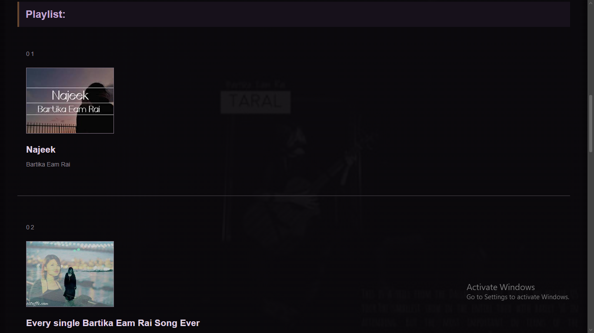
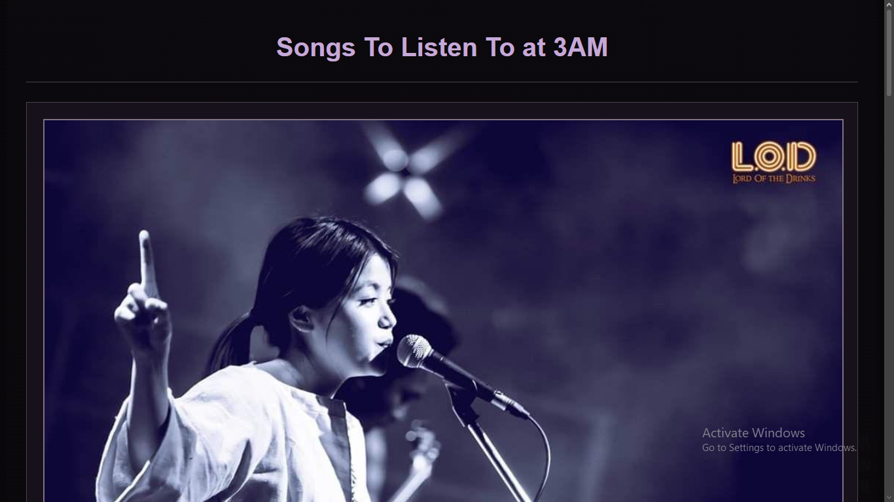

# Songs For 3AM

Demo: https://lwhsbg.github.io/Songs-For-3Am/

# What It Is

A simple site I had made for song recomendations for late night listening while on boba bash delhi. Did not reach the minimum project time in 3am so it was just sitting around and then I decided to work on it way more than what it initially was. 

# How to run it

It is just a website with my recommendations of songs, and i have linked the spotify to wach and every section of the songs there, so just hover your cursor on it, and click it and you will be redirected to the respective suggestion.

# Given songs:

All of the songs are from a single artist, Bartika Eam Rai:

-Najeek
-Tadhaa

Albums:

-Si Ma Na
-Taral
-Aandhi Ityaadi
-Bimbaakash

# Why I Made It

Heard the dark theme and my mind immediately went to songs I listen to late at night. Might be a bit biased towards a specific singer but yeah basically 100 percent recommended playlist that everyone should definitely compulsorily have in their listening queue.

# How I Made It

It's just simple HTML, CSS I used from Boba Bash workshop.

# What I struggled with and what I learnt

All I know are the plain basics of HTML and CSS and I learned many new stuff while doing this project such as keeping images and backgrounds and adding links to spotify when you click on the song in the website. Overall HTML and CSS are a really fun language to learn.

# Preview Images:

